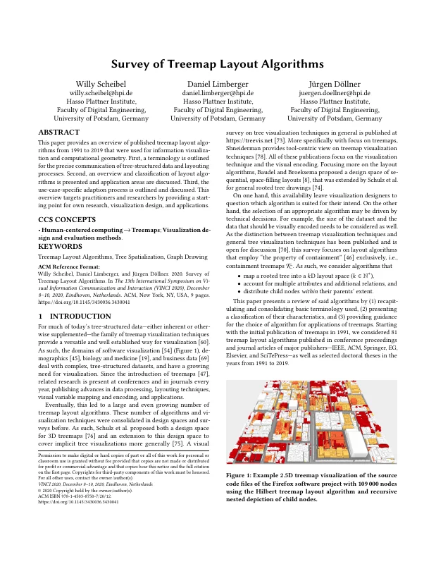
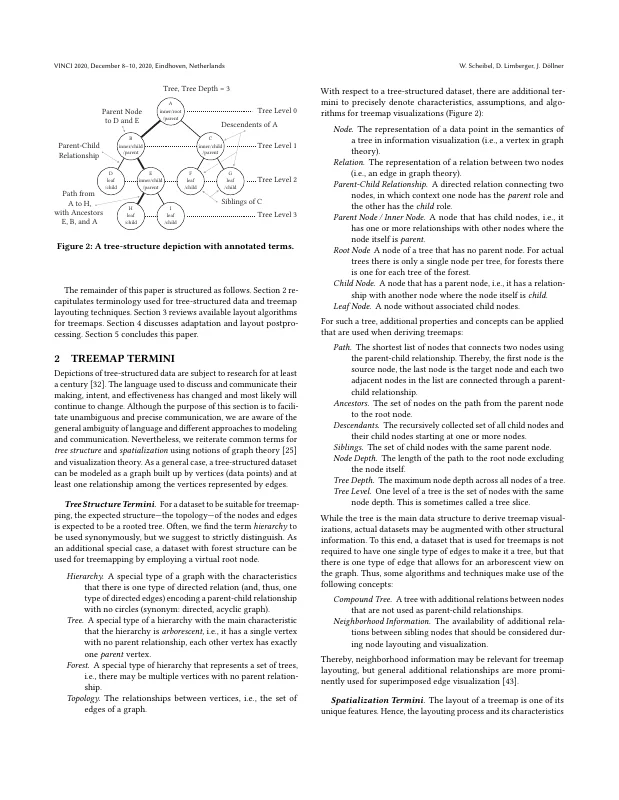
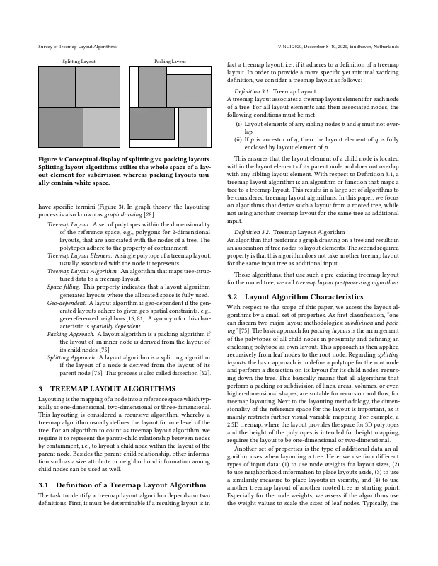
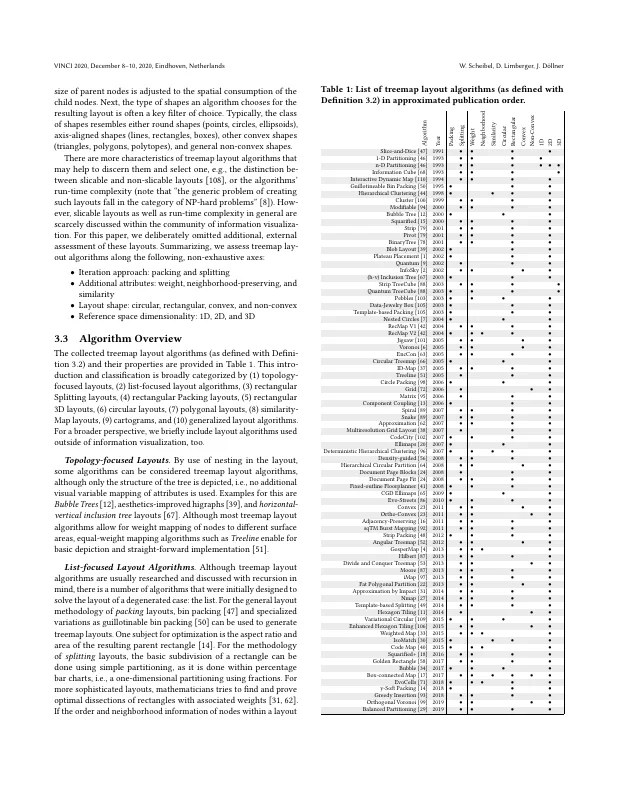
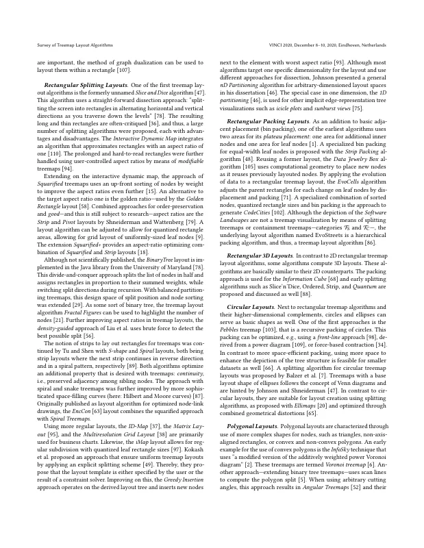
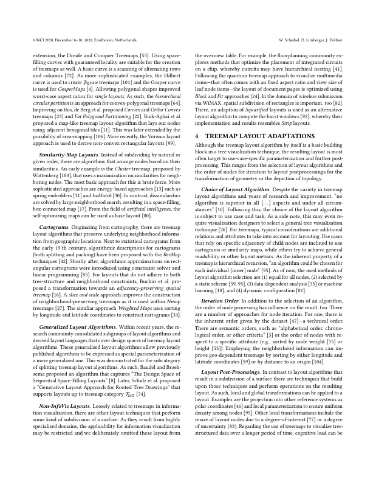
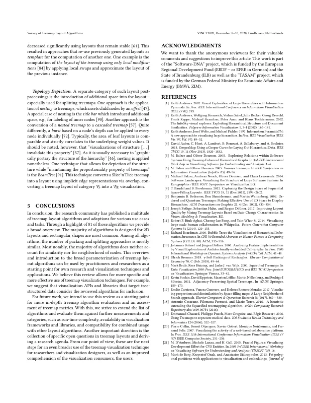
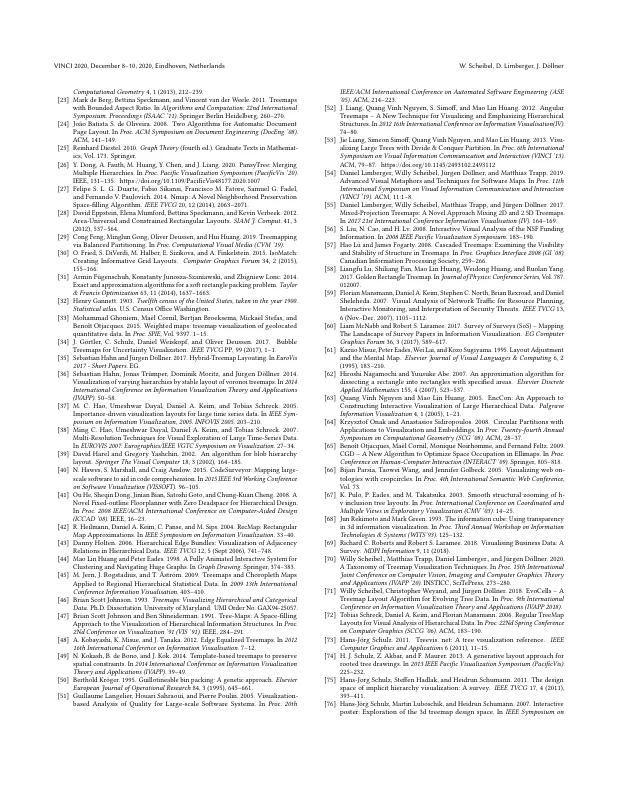
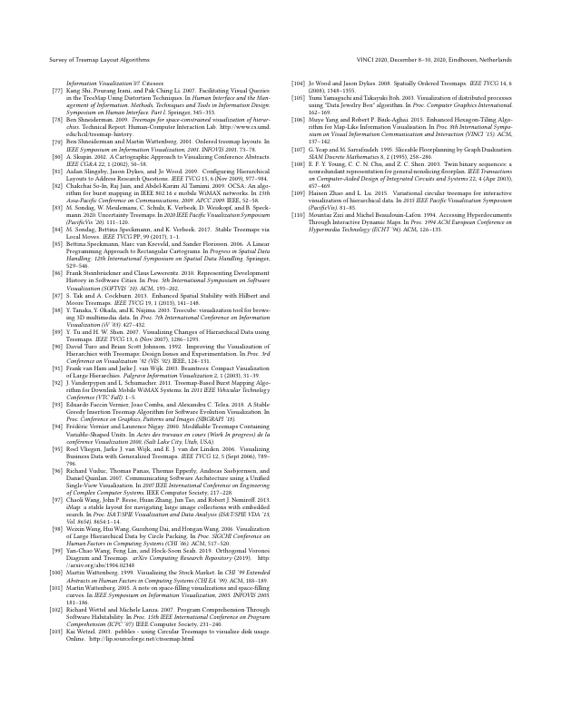

# Survey of Treemap Layout Algorithms

[Willy Scheibel](https://orcid.org/0000-0002-7885-9857), [Daniel Limberger](https://orcid.org/0000-0002-9111-4809), and [Jürgen Döllner](https://orcid.org/0000-0002-8981-8583)

*Proceedings of the 13th International Symposium on Visual Information Communication and Interaction (VINCI '20)*, December 8–10, 2020, Eindhoven, Netherlands. ACM, pp. 1:1–9.

DOI: [10.1145/3430036.3430041](https://doi.org/10.1145/3430036.3430041) · Author's version: [Zenodo](https://doi.org/10.5281/zenodo.24121573) · [ResearchGate](https://www.researchgate.net/publication/346565429)

> This paper provides an overview of published treemap layout algorithms from 1991 to 2019 that were used for information visualization and computational geometry.
> First, a terminology is outlined for the precise communication of tree-structured data and layouting processes.
> Second, an overview and classification of layout algorithms is presented and application areas are discussed.
> Third, the use-case-specific adaption process is outlined and discussed.
> This overview targets practitioners and researchers by providing a starting point for own research, visualization design, and applications.

<p><a href="scheibel2020-layouts-as-submitted.pdf"></a> <a href="scheibel2020-layouts-as-submitted.pdf"></a> <a href="scheibel2020-layouts-as-submitted.pdf"></a> <a href="scheibel2020-layouts-as-submitted.pdf"></a></p>
<details><summary>Remaining 5 pages</summary><p><a href="scheibel2020-layouts-as-submitted.pdf"></a> <a href="scheibel2020-layouts-as-submitted.pdf"></a> <a href="scheibel2020-layouts-as-submitted.pdf"></a> <a href="scheibel2020-layouts-as-submitted.pdf"></a> <a href="scheibel2020-layouts-as-submitted.pdf"></a></p></details>

## Contents

- [`src/`](src/) – LaTeX sources of the camera-ready version (ACM `acmart` v1.67, sigconf)
- [`scheibel2020-layouts-as-submitted.pdf`](scheibel2020-layouts-as-submitted.pdf) – camera-ready PDF as submitted to ACM
- [`build.sh`](build.sh) – reproducible build with TeX Live 2020 (podman or docker)
- [`preview/`](preview/) – page previews for this README

## Build

```bash
./build.sh        # → build/main.pdf
```

The bundled `acmart.cls` (v1.67, 2020) is built in a TeX Live 2020 container to stay close to the original toolchain.
The build reproduces `scheibel2020-layouts-as-submitted.pdf` (same 9 pages and layout; the CCS concepts line and bold-italic headings/captions differ marginally in glyph rendering).
Figure 2 uses the final `tree-taxonomy.pdf` (label "Siblings in C"), which was updated after `scheibel2020-layouts-as-submitted.pdf` was last built ("Siblings of C").

## Versions

- [`v1.0-camera-ready`](https://github.com/dl-archive/article.2020-vinci-survey-layouts/tree/v1.0-camera-ready) – sources as submitted to ACM (2020-11-03)

## Citation

```bibtex
@InProceedings{scheibel2020-layouts,
  author    = {Scheibel, Willy and Limberger, Daniel and D{\"o}llner, J{\"u}rgen},
  title     = {Survey of Treemap Layout Algorithms},
  booktitle = {Proceedings of the 13th International Symposium on Visual Information Communication and Interaction},
  year      = {2020},
  series    = {VINCI~'20},
  publisher = {ACM},
  pages     = {1:1--9},
  doi       = {10.1145/3430036.3430041},
  isbn      = {978-1-450387-50-7},
}
```
